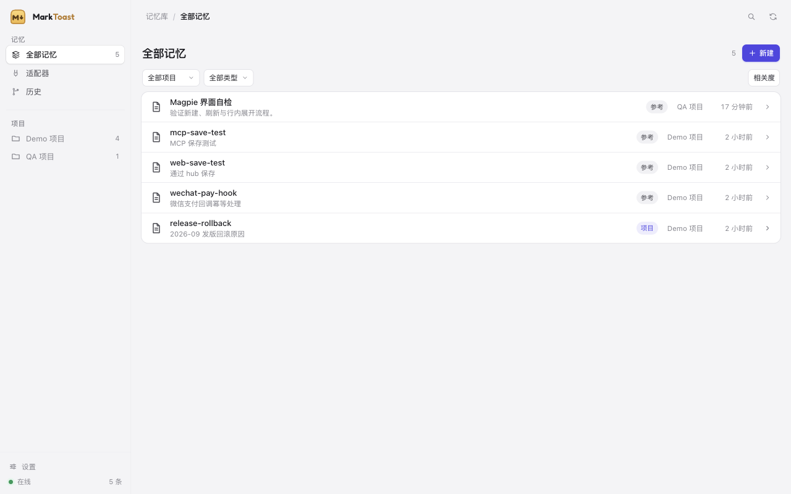
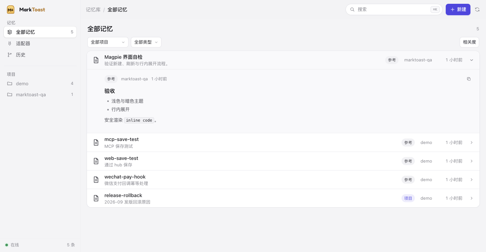
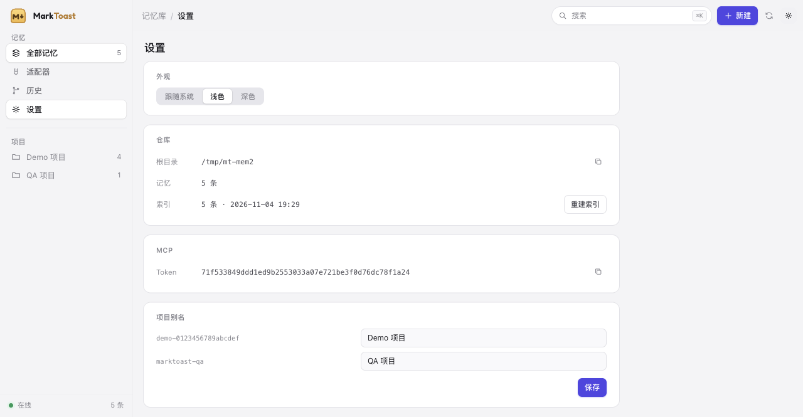

<div align="center">

# MarkToast · 马克吐司

**Every agent's memory. One place. Yours.**

Local-first, Git-versioned Markdown memory for every coding agent.<br>
All **40 harnesses built in** — ZCode, Claude Code, Codex, Cursor, Gemini CLI,
DSH, Hermes, Pi and the rest.


[](https://github.com/realchendahuang/MarkToast/stargazers)

[中文](README.zh-CN.md) · [Brand](docs/BRAND.md) · [Product](docs/PRODUCT.md) · [Tech stack](docs/TECH-STACK.md) · [Architecture](docs/ARCHITECTURE.md) · [Roadmap](docs/ROADMAP.md) · [Credits](docs/CREDITS.md)

</div>





---

## Why MarkToast

Every harness remembers differently. Claude Code keeps notes, Codex keeps a
different file, ZCode invented a third format, DSH plugins a fourth — and when
you switch tools, the memory stays behind. Your memory ends up fragmented, tied
to one tool, and invisible to the next agent.

MarkToast treats memory as what it should be: **a repository you own.**

- **One Markdown repository is the source of truth.** Readable, greppable,
  diffable, editable in Obsidian.
- **Git is the workflow.** Every memory change is a diff. Branches are memory
  experiments. History is an audit trail, and any memory can be rolled back
  from its own version history in the desktop UI.
- **A local hub serves every harness.** Instruction-file projection where the
  harness reads files, MCP where it speaks MCP, native plugins where it allows
  one.
- **Federation over migration.** Adapters talk to each harness's own memory
  where possible; import is a fallback, not a requirement.
- **Local-first, zero cloud.** No account, no telemetry. Cross-machine sync is
  your own Git remote.
- **Chinese-first.** CJK-aware full-text search is a first-class feature.

## Architecture

```
                        ┌──────────────────────────────┐
                        │  Markdown memory repository  │  ← single source of truth
                        │  projects/<key>/memory/      │    (Git-versioned, human-readable)
                        │  global/                     │
                        └──────────────┬───────────────┘
                                       │  atomic writes / per-root lock / stale-index refresh
                        ┌──────────────┴───────────────┐
                        │        core (Go)             │
                        │  store · index (FTS5+CJK)    │
                        │  git (batched commits)       │
                        │  hub (HTTP + MCP)            │
                        └──────┬───────────────┬───────┘
                               │               │
                      CLI `marktoast`     Wails v3 desktop (embedded UI)
                               │
             ┌─────────────────┴──────────────────┐
             │  adapters (YAML descriptors)       │
             │  T1 instruction projection         │  AGENTS.md / CLAUDE.md marker blocks
             │  T2 session ingest                 │  read-only candidate memories
             │  T3 MCP tools                      │  any MCP client
             │  T4 native plugins                 │  ZCode hooks · Hermes provider · DSH plugin
             └────────────────────────────────────┘
                               │
                    optional: your own git remote (cross-machine, teams)
```

## How it works

1. `marktoast init` creates `~/Memory` (or `--root`) and `git init`s it.
2. Memories are one Markdown file each, with YAML frontmatter — the ZCode
   project-memory format, so existing memories import without conversion.
3. `MEMORY.md` is a generated index; the SQLite FTS5 index is derived and
   rebuildable (`marktoast reindex`).
4. `marktoast serve` exposes the local hub; each harness adapter projects the
   index into that harness's own instruction/memory surface.
5. `git log` is your memory's history. `git revert` is your undo.
6. The local hub binds to loopback only. Browser API calls use an HttpOnly,
   SameSite session cookie plus Host/Origin checks; script clients and MCP use
   a bearer token stored under `.marktoast/`.

## Status

**Public pre-alpha — core loop, hardened local hub, embedded-UI desktop shell,
CI and signed-release validation are implemented.**

- [x] Go module + CLI (`version`, `init`, `add`, `get`, `search`, `reindex`,
      `log`, `status`, `hook`, `mcp`, `adapters`, `serve`, `ui`)
- [x] SQLite FTS5 index with a dependency-free CJK bigram tokenizer
      (two-character Chinese queries work; OR + BM25 ranking)
- [x] Markdown repository with atomic writes, per-root advisory locks,
      collision-safe filenames, Git commits limited to managed memory paths,
      and debounced auto-commit flush on shutdown
- [x] **40 built-in harness adapters** — 19 `auto` (MarkToast merges the config),
      12 `staged` (ready-to-paste hooks/MCP snippets) and 9 `mcp_only` (MCP
      registration only); one YAML descriptor per harness
- [x] Generic installer engine: JSON/TOML merge, backups, idempotent writes and
      third-party entries preserved; snippet generation for staged/MCP-only
- [x] Loopback-only local hub with cookie/bearer authentication, CSRF and Host
      checks, paginated status/search/memory/memories/projects/adapters/git-log
      APIs; MCP over stdio and streamable HTTP (`memory_search/get/save/list`)
- [x] Web UI follows Magpie's design language (MIT): its design tokens (light default +
auto dark, indigo accent), 212px sidebar, breadcrumb header, white list cards and
rows, **its motion** (view fade-up, segmented thumb glide 280ms, row fold 420ms,
dialog in/out, skeleton shimmer, reduced-motion), modal, Cmd/Ctrl+K
- [x] Wails v3.1 desktop shell with embedded web UI (`make desktop`; opens the same hub in a native window)
- [x] Adapter page in the web UI lists all 40 harnesses grouped by install mode,
      with detection/install state and connect / generate-snippets actions

### Support matrix

All 40 adapters ship in the binary. "Built in" means the descriptor is embedded,
`marktoast adapters list` shows it and the installer supports its mode;
per-harness end-to-end verification is tracked in
[ROADMAP.md](docs/ROADMAP.md). † = the upstream ai-memory recipe is
documentation-only (not verified end to end).

#### Automatic · auto · 19 harnesses

MarkToast merges the harness config directly, with a backup and third-party entries kept.

| Harness | ID | Integration | Tier | Status |
|---|---|---|---|---|
| Antigravity CLI (agy) | `antigravity-cli` | Automatic | projection | Built in |
| Claude Code | `claude-code` | Automatic | projection | Built in |
| Claude Desktop (Code tab) | `claude-desktop-code` | Automatic | projection | Built in |
| CodeBuddy Code | `codebuddy` | Automatic | projection | Built in |
| Codex | `codex` | Automatic | projection | Built in |
| Command Code | `command-code` | Automatic | projection | Built in |
| Cursor | `cursor` | Automatic | projection | Built in |
| Devin CLI | `devin` | Automatic | projection | Built in |
| Factory Droid | `factory-droid` | Automatic | projection | Built in |
| Gemini CLI | `gemini-cli` | Automatic | projection | Built in |
| GitHub Copilot CLI | `copilot-cli` | Automatic | projection | Built in |
| Grok Build CLI | `grok` | Automatic | projection | Built in |
| IBM Bob | `ibm-bob` | Automatic | projection | Built in |
| Kimi Code | `kimi-code` | Automatic | projection | Built in |
| Meta Muse Code | `meta-muse` | Automatic | projection | Built in |
| Qoder | `qoder` | Automatic | projection | Built in |
| Qwen Code | `qwen-code` | Automatic | projection | Built in |
| ZCode | `zcode` | Automatic | native | Built in |
| Zero (Gitlawb/zero) | `zero` | Automatic | projection | Built in |

#### Staged snippets · staged · 12 harnesses

Writes ready-to-paste hooks / MCP snippets to merge by hand or install as a plugin.

| Harness | ID | Integration | Tier | Status |
|---|---|---|---|---|
| Cline CLI | `cline` | Hooks snippet | projection | Built in |
| Crush | `crush` | Hooks snippet | readonly | Built in |
| DeepSeek Harness | `dsh` | Hooks snippet | projection | Built in |
| GrizzyBot | `grizzybot` | Hooks snippet | readonly | Built in |
| Hermes Agent | `hermes` | Hooks snippet | native | Built in |
| Kiro CLI | `kiro-cli` | Hooks snippet | projection | Built in |
| Oh My Pi (OMP) | `oh-my-pi` | Hooks snippet | projection | Built in |
| OpenClaw | `openclaw` | Hooks snippet | projection | Built in |
| OpenCode | `opencode` | Hooks snippet | projection | Built in |
| Pi | `pi` | Hooks snippet | projection | Built in |
| Pool (Poolside Agent CLI) | `pool` | Hooks snippet | projection | Built in |
| Swival CLI | `swival-cli` | Hooks snippet | readonly | Built in |

#### MCP only · mcp_only · 9 harnesses

Writes an MCP snippet only; no lifecycle hooks are installed.

| Harness | ID | Integration | Tier | Status |
|---|---|---|---|---|
| Claude Desktop (Chat) | `claude-desktop-chat` | MCP | readonly | Built in |
| FreeBuff | `freebuff` | MCP | readonly | Built in |
| Goose | `goose` | MCP | readonly | Built in † |
| Kilo Code | `kilo-code` | MCP | readonly | Built in † |
| OpenHuman | `openhuman` | MCP | readonly | Built in † |
| Prime Agent | `prime-agent` | MCP | readonly | Built in |
| VS Code Copilot | `vs-code-copilot` | MCP | readonly | Built in |
| Warp | `warp` | MCP | readonly | Built in † |
| Zed | `zed` | MCP | readonly | Built in |

**Tiers:** `native` (2) — the harness has its own memory format MarkToast can read
and write; `projection` (26) — instruction files / hooks / MCP only; `readonly` (12)
— MarkToast reads or injects but never writes the harness's own memory.

**Integration:** `Automatic` — MarkToast merges the harness config (backup first);
`Hooks snippet` — MarkToast writes ready-to-paste hooks/MCP files;
`MCP` — MCP registration only, no lifecycle hooks.

See [docs/ROADMAP.md](docs/ROADMAP.md).

## Install

The canonical CLI entry point is `cmd/marktoast` (there is no root-level
`main.go`). From a checkout:

```bash
go install ./cmd/marktoast
```

Or install the latest tagged module version:

```bash
go install github.com/realchendahuang/MarkToast/cmd/marktoast@latest
```

### Prebuilt binaries

Every tagged release publishes:

- `MarkToast-desktop-<version>-<os>-<arch>.dmg` / `.zip` / `.tar.gz` — the
  desktop app for macOS (Apple Silicon and Intel), Linux (arm64, x86_64) and
  Windows (arm64, x86_64)
- `marktoast-<version>-<os>-<arch>.tar.gz` (`.zip` on Windows) — the CLI with
  the web UI embedded, for macOS, Linux and Windows on arm64 and amd64

Get them from the [latest release](https://github.com/realchendahuang/MarkToast/releases/latest).
The macOS app is ad-hoc signed (no notarization yet): right-click → **Open**,
or `xattr -d com.apple.quarantine /Applications/MarkToast.app`. The Linux app
needs GTK 4 + WebKitGTK 6.0 (`apt install libgtk-4-1 libwebkitgtk-6.0-4`);
the Windows app needs the WebView2 runtime.

## Quick start (development)

Requirements: Go 1.26+, git, and Node.js 20+ for the JavaScript syntax check in
`make verify`. macOS is the primary target; building the Wails desktop shell also
needs Xcode command-line tools. The web UI is embedded in the native app, so
there is no separate frontend build step.

```bash
make verify                                  # fmt, tidy, vet, race tests, JS syntax, build
./bin/marktoast version
./bin/marktoast init                         # creates ~/Memory + git repo
./bin/marktoast import zcode                 # import existing harness memories
./bin/marktoast backup                       # tar.gz snapshot
./bin/marktoast doctor                       # diagnose the installation
./bin/marktoast update                       # check GitHub Releases
./bin/marktoast inbox list                   # review session candidates
./bin/marktoast add --name release-rollback \
  --description "2026-09 发版回滚原因" --type project --body "发版后首页闪屏，决定回滚。"
./bin/marktoast search "回滚"
./bin/marktoast tui                          # terminal UI
./bin/marktoast serve                        # embedded web UI at http://127.0.0.1:3777
make desktop                                 # native Wails shell, embedded UI
./bin/marktoast-desktop
./bin/marktoast mcp                          # stdio MCP server for harnesses
./bin/marktoast diff release-rollback        # show the last patch
./bin/marktoast rollback release-rollback --yes
./bin/marktoast adapters install zcode       # dry run; add --apply to write
cp -R adapters/hermes/marktoast ~/.hermes/plugins/marktoast  # Hermes provider
make install                                 # CLI + MarkToast.app (install script builds)
```

## Standing on shoulders · 致敬

MarkToast is built in public debt to these projects — see
[docs/CREDITS.md](docs/CREDITS.md) for exactly what we borrow.

- **[magpie](https://github.com/yetone/magpie)** (MIT) — the product shape we
  aspire to: Go + Wails v3, system WebView, vanilla frontend, local hub, config
  writers for every agent.
- **[ai-memory](https://github.com/akitaonrails/ai-memory)** (MIT) — Markdown
  source of truth, derived index, Git-backed memory engine ideas, and the
  cross-harness support matrix / hook patterns that MarkToast's 40 YAML
  descriptors were ported from (see [docs/CREDITS.md](docs/CREDITS.md)).
- **[ZCode](https://github.com/zai-org/ZCode)** (Apache-2.0) — the project
  memory format MarkToast adopts (`MEMORY.md` index + one Markdown file per
  fact + frontmatter).
- **[Hermes Agent](https://github.com/NousResearch/hermes-agent)** (MIT) and
  **[DeepSeek Harness](https://github.com/deepseek-ai/deepseek-harness)** (MIT)
  — the harness integration surfaces (memory provider, plugin/MCP seams).
- **[EverOS](https://github.com/EverMind-AI/EverOS)** (Apache-2.0),
  **[memsearch](https://github.com/zilliztech/memsearch)** (MIT) — local-first
  Markdown memory and hybrid retrieval precedents.
- **[Wails](https://github.com/wailsapp/wails)** (MIT), **[moejs](https://github.com/MoeForge/moejs)**
  (Apache-2.0) — the desktop shell and future plugin engine.

## Docs

| Doc | What |
|---|---|
| [Brand](docs/BRAND.md) | Logo, colours, type, asset list |
| [Plugins](docs/PLUGINS.md) | JS plugin API and events |
| [Release](docs/RELEASE.md) | Signing, notarization, publishing checklist |
| [Product](docs/PRODUCT.md) | Positioning, users, non-goals, success metrics |
| [Tech stack](docs/TECH-STACK.md) | Every decision, with alternatives and risks |
| [Architecture](docs/ARCHITECTURE.md) | Components, storage layout, adapters, failure modes |
| [Roadmap](docs/ROADMAP.md) | M0–M5 |
| [Reuse research](docs/RESEARCH-REUSE.md) | What we reuse from the open-source memory ecosystem (and what we must not) |
| [Harness integration](docs/HARNESS-INTEGRATION.md) | How MarkToast wires all 40 harnesses: install modes, per-harness targets/events/injection, pitfalls |
| [Credits](docs/CREDITS.md) | Who we learned from, and under which license |
| [Desktop](docs/DESKTOP.md) | Wails v3 desktop shell, packaging, and release notes |
| [Adapters](adapters/README.md) | How to add a harness |

## License

MIT (see [LICENSE](LICENSE)).

Issues and pull requests are welcome. If MarkToast is useful to you, a star
helps other agent users find it.

## Star history

[](https://star-history.com/#realchendahuang/MarkToast&Date)
