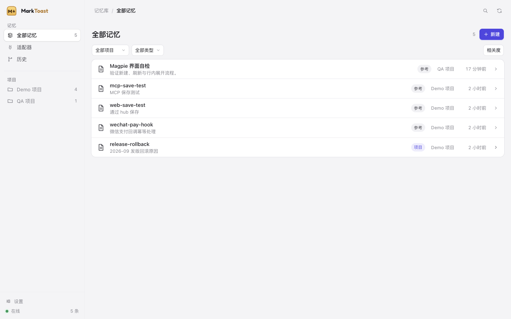
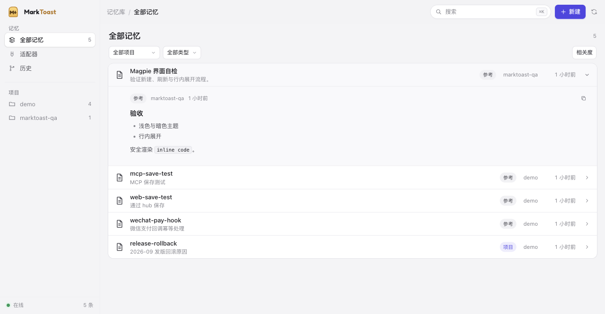

<div align="center">

# MarkToast · 马克吐司

**每个 agent 的记忆，一处存放，归你所有。**

本地优先、Git 版本化的 Markdown 记忆中枢，适配所有 coding agent。<br>
先接 ZCode、Hermes、DSH，再扩到 Codex、Claude Code、Pi 等。


-lightgrey)

[English](README.md) · [产品定位](docs/PRODUCT.md) · [技术栈](docs/TECH-STACK.md) · [架构设计](docs/ARCHITECTURE.md) · [路线图](docs/ROADMAP.md) · [致敬](docs/CREDITS.md)

</div>




---

## 为什么需要 MarkToast

每个 harness 都在记，但各记各的：Claude Code 有自己的一套笔记，Codex 是另一个文件，
ZCode 发明了第三种格式，DSH 的插件生态里又有第四种。你换个工具，记忆就留在上一个工具里
——它被工具绑架、被格式割裂、对下一个 agent 不可见。

MarkToast 把记忆还原成它本该有的样子：**一个你拥有的仓库。**

- **一份 Markdown 仓库就是唯一真源。** 可读、可 grep、可 diff，Obsidian 直接打开。
- **Git 就是工作流。** 每次记忆变更都是一次 diff；分支是记忆实验；历史是审计线；
  每条记忆都有自己的版本历史，可以在桌面端直接恢复旧版本（生成一次新提交）。
- **一个本地中枢服务所有 harness。** 能读指令文件的就投影进去，支持 MCP 的走 MCP，
  有插件机制的上原生插件。
- **先联邦，后搬家。** 适配器优先对接各家原生记忆；导入只是兜底，不是前提。
- **本地优先，零云端。** 不要账号、不上报数据；跨机同步用你自己的 Git remote。
- **中文优先。** CJK 分词与子串检索是一等公民。

## 架构

```
                        ┌──────────────────────────────┐
                        │      Markdown 记忆仓库        │  ← 唯一真源
                        │  projects/<key>/memory/      │    （Git 版本化、人类可读）
                        │  global/                     │
                        └──────────────┬───────────────┘
                                       │  监听 / 原子写 / flock
                        ┌──────────────┴───────────────┐
                        │        core（Go）             │
                        │  store · index（FTS5+CJK）    │
                        │  git（批量提交）               │
                        │  hub（HTTP + MCP）            │
                        └──────┬───────────────┬───────┘
                               │               │
                      CLI `marktoast`     Wails v3 桌面（M4）
                               │
             ┌─────────────────┴──────────────────┐
             │  适配器（YAML 描述符）                │
             │  T1 指令投影                        │  AGENTS.md / CLAUDE.md marker 块
             │  T2 会话摄取                        │  只读候选记忆
             │  T3 MCP 工具                        │  任意 MCP 客户端
             │  T4 原生插件                        │  ZCode hooks · Hermes provider · DSH plugin
             └────────────────────────────────────┘
                               │
                     可选：你自己的 Git remote（跨机 / 团队）
```

## 怎么运转

1. `marktoast init` 创建 `~/Memory`（或 `--root`）并 `git init`。
2. 每条记忆一个 Markdown 文件 + YAML frontmatter —— 采用 ZCode 项目记忆格式，
   现有记忆可无转换导入。
3. `MEMORY.md` 是生成的索引；SQLite FTS5 索引是派生物，可随时 `marktoast reindex` 重建。
4. `marktoast serve` 起本地 hub；每家 harness 的适配器把索引投影进它自己的
   指令/记忆接口。
5. `git log` 就是记忆的历史，`git revert` 就是撤销。

## 现状

**私有 pre-alpha —— 核心闭环已跑通（M1–M3），桌面壳下一步（M4）。**

- [x] Go module + CLI（`version` / `init` / `add` / `get` / `search` / `reindex` /
      `log` / `status` / `hook` / `mcp` / `adapters` / `serve` / `ui`）
- [x] SQLite FTS5 索引 + 零依赖 CJK bigram 分词（两字中文可命中；OR + BM25 排序）
- [x] Markdown 仓库 + Git 提交（当前每次变更一次提交，debounce 批量提交待做）
- [x] 适配器描述符（hooks / MCP / session）；ZCode 幂等安装器（hooks + MCP，保留第三方条目）；
      DSH / Hermes 已做半自动 staged 安装
- [x] 本地 hub：status/search/memory/memories/projects/adapters/git-log API；
      MCP server（stdio + streamable HTTP，`memory_search/get/save/list`）
- [x] Web UI 采用 Magpie 的设计语言（MIT）：同一套 design tokens（浅色默认 + 自动暗色、靛蓝强调色）、212px 侧栏、面包屑头部、白色列表卡片与行、**Magpie 同款交互动画**（视图淡入、分段控件 thumb 滑动 280ms、行展开折叠 420ms、弹层进出、骨架 shimmer、reduced-motion）、弹层、Cmd/Ctrl+K
- [x] Wails v3.1 桌面壳（`make desktop`；原生窗口加载同一个 hub）
- [ ] debounce 提交、会话摄取、Hermes memory provider、更多适配器

详见 [docs/ROADMAP.md](docs/ROADMAP.md)。

## 快速开始（开发）

```bash
make build
./bin/marktoast version
./bin/marktoast init                         # 创建 ~/Memory + git 仓库
./bin/marktoast add --name release-rollback \
  --description "2026-09 发版回滚原因" --type project --body "发版后首页闪屏，决定回滚。"
./bin/marktoast search "回滚"
./bin/marktoast serve                        # http://127.0.0.1:3777（Web UI）
make desktop && ./bin/marktoast-desktop              # 原生 Wails 窗口
./bin/marktoast mcp                          # 给 harness 的 stdio MCP server
./bin/marktoast adapters install zcode       # 默认 dry-run；加 --apply 写入
```

依赖：Go 1.26+、git。macOS 优先；Windows/Linux 保持可编译，但不是 v1 目标。

## 致敬 · Standing on shoulders

MarkToast 站在这些项目肩上——具体借鉴了什么见 [docs/CREDITS.md](docs/CREDITS.md)。

- **[magpie](https://github.com/yetone/magpie)**（MIT）——我们想成为的产品形态：
  Go + Wails v3、系统 WebView、原生前端、本地 hub、给每个 agent 写配置。
- **[ai-memory](https://github.com/akitaonrails/ai-memory)**（MIT）——Markdown 为源、
  派生索引、Git-backed 记忆引擎的思路。
- **[ZCode](https://github.com/zai-org/ZCode)**（Apache-2.0）——MarkToast 采用的项目
  记忆格式（`MEMORY.md` 索引 + 一条事实一个 Markdown + frontmatter）。
- **[Hermes Agent](https://github.com/NousResearch/hermes-agent)**（MIT）与
  **[DeepSeek Harness](https://github.com/deepseek-ai/deepseek-harness)**（MIT）——
  harness 接入面（memory provider、插件/MCP 接缝）。
- **[EverOS](https://github.com/EverMind-AI/EverOS)**（Apache-2.0）、
  **[memsearch](https://github.com/zilliztech/memsearch)**（MIT）——本地优先 Markdown
  记忆与混合检索的先例。
- **[Wails](https://github.com/wailsapp/wails)**（MIT）、
  **[moejs](https://github.com/MoeForge/moejs)**（Apache-2.0）——桌面壳与未来的插件引擎。

## 文档

| 文档 | 内容 |
|---|---|
| [品牌规范](docs/BRAND.md) | Logo、颜色、字体、资产清单 |
| [插件](docs/PLUGINS.md) | JS 插件 API 与事件 |
| [产品定位](docs/PRODUCT.md) | 用户、场景、非目标、成功指标 |
| [技术栈](docs/TECH-STACK.md) | 每个选型的理由、备选与风险 |
| [架构设计](docs/ARCHITECTURE.md) | 组件、存储布局、适配器、故障模式 |
| [路线图](docs/ROADMAP.md) | M0–M5 |
| [复用调研](docs/RESEARCH-REUSE.md) | 开源记忆生态里哪些能复用、哪些不能碰 |
| [harness 接入](docs/HARNESS-INTEGRATION.md) | ZCode / DSH / Hermes / Claude Code / Codex 的接线参考矩阵 |
| [致敬](docs/CREDITS.md) | 向谁学习、在什么许可下 |
| [桌面壳](docs/DESKTOP.md) | Wails v3 计划（M4） |
| [适配器](adapters/README.md) | 如何新增一家 harness |

## 许可证

采用 **MIT**（见 [LICENSE](LICENSE)）；开发期仓库保持私有。
